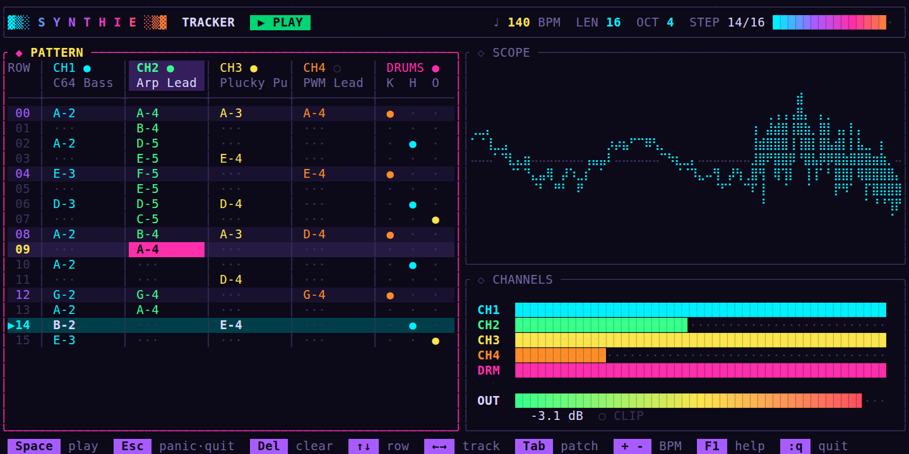
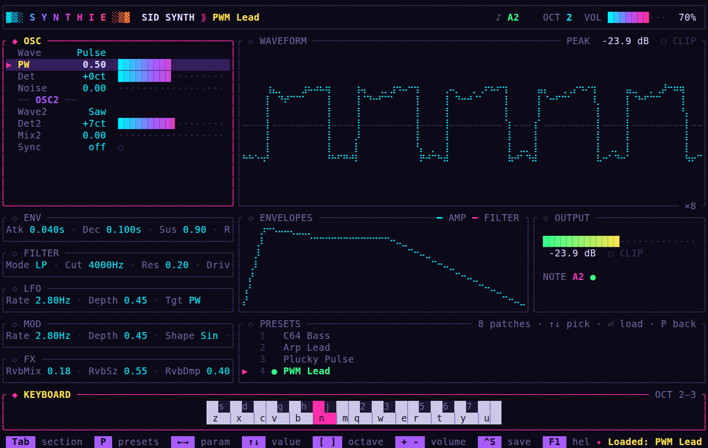

# synthie

[](https://crates.io/crates/synthie)
[](https://docs.rs/synthie)
[](https://www.npmjs.com/package/@sunsided/synthie)
[](https://sunsided.github.io/synth/)
[](https://github.com/sunsided/synth/actions/workflows/test.yml)
[](https://github.com/sunsided/synth/actions/workflows/format.yml)
[](https://github.com/sunsided/synth/actions/workflows/fuzz-check.yml)

A polyphonic DSP engine library for Rust. Ships with a terminal synthesizer as its primary demo.

**Try it in the browser:** [sunsided.github.io/synth](https://sunsided.github.io/synth/). Both terminal front-ends, the synth and the tracker, are compiled to WebAssembly and run there unchanged.

## Workspace

| Crate | Type | Description |
|---|---|---|
| [`synthie`](crates/synthie/) | library | DSP engine: oscillators, envelopes, filter, LFO, reverb, preset system |
| [`synth-tui`](crates/synth-tui/) | binary | Terminal synthesizer — interactive demo of the engine |
| [`synthie-tracker`](crates/synthie-tracker/) | binary | **Step-sequencer tracker TUI** — 4-channel pattern editor with drum track |
| [`synthie-ui`](crates/synthie-ui/) | library | Shared neon look for both TUIs — palette, panels, meters, piano strip, scope |
| [`synthie-wasm`](crates/synthie-wasm/) | npm package | WebAssembly bindings, published as [`@sunsided/synthie`](crates/synthie-wasm/npm/README.md) for browsers (AudioWorklet) and Node.js |

## Library

### Features

- **Five waveforms:** Pulse, Sawtooth, Triangle, Noise, Pulse+Saw
- **ADSR amplitude envelope** with optional reverse (swell/duck) mode
- **State-variable filter** — Low-pass, Band-pass, and High-pass modes with cutoff, resonance, and pre-filter drive
- **LFO** with selectable targets: pitch (vibrato), pulse width, filter cutoff, or volume (tremolo)
- **Reverb FX** with room size and high-frequency damping controls
- **Global controls:** master volume and portamento (glide) time
- **Preset system** with built-in SID-style patches and save/load support
- **Optional `serde` support** for patch serialisation (enabled by default)

### Quick Start

Add as a path or git dependency, then:

```rust
use synthie::prelude::*; // SynthParams, Patch, AudioEvent, MidiNote, setup_audio, …

fn main() -> anyhow::Result<()> {
    let patches = presets::sid::default_patches();
    let (_stream, tx, _rx) = setup_audio()?;

    // Load first preset
    let params = Box::new(patches[0].params.clone());
    tx.send(AudioEvent::LoadPatch(params))?;

    // Play middle C on channel 0
    tx.send(AudioEvent::NoteOn(ChannelNo(0), MidiNote(60)))?;
    std::thread::sleep(std::time::Duration::from_secs(1));
    tx.send(AudioEvent::NoteOff(ChannelNo(0), MidiNote(60)))?;
    Ok(())
}
```

### Examples

Run any example with `cargo run -p synth --example <name> --release`.

| Example | Description |
|---|---|
| `tune` | Multi-channel chords, melody, and drums — general engine showcase |
| `lazy_jones` | Lazy Jones (David Whittaker, 1984) — the C64 hook that became Kernkraft 400 |
| `kernkraft` | Kernkraft 400 (Zombie Nation, 1999) — full song structure, two channels |

## Synthie Tracker

A step sequencer with up to 128 steps (eight bars of 16ths), 4 independent synth channels and a drum track (kick, closed/open hi-hat), powered by the same `synthie` DSP engine. Notes sustain until the next note or a note-off (`===`) on the same track.

It starts with the Lazy Jones / Kernkraft 400 hook loaded: the line's melody and bass split across two tracks, the off-beat sub-bass on the second pass, and four-on-the-floor drums. Press `Space` to play.



```sh
task tracker          # or: cargo run -p synthie-tracker --release
task tracker:web      # browser build with live reload (needs trunk)
```

### Controls

| Key | Action |
|---|---|
| `Space` | Play / Stop |
| `Esc` | Stop playback, silence all voices, then ask whether to quit (in the browser: stop only) |
| `:q` `Enter` | Quit right away (also `:wq`, `:x`) |
| `↑` / `↓` / `←` / `→` | Move cursor |
| `Tab` / `Shift+Tab` | Next / previous preset on current track |
| `Z`–`M`, `Q`–`U` | Enter note (lower / upper octave row, same layout as synth-tui) |
| `1` / `` ` `` | Note off (`===`) |
| `Del` / `Bksp` | Clear step |
| `k` / `h` / `o` | Toggle kick / closed hi-hat / open hi-hat (drum track) |
| `+` / `-` | BPM up / down |
| `[` / `]` | Octave down / up |
| `PgUp` / `PgDn` | Extend / shorten pattern |
| `F1` | Toggle key-reference overlay |
| `Ctrl+C` / `Ctrl+Q` / `F12` | Quit |

> **Terminal compatibility:** Note-off on note entry requires keyboard enhancement support (kitty protocol, WezTerm). In terminals without it, each note entry is still correctly gated per step.

## TUI Demo (synth-tui)



### Build and Run

```sh
cargo run -p synth-tui --release
task synth:web        # browser build with live reload (needs trunk)
```

Or build first, then run directly:

```sh
cargo build --release
./target/release/synth-tui
```

> **Note:** The synthesizer runs in the terminal's alternate screen with raw mode enabled. Your normal terminal session is fully restored on exit.

### Controls

#### Piano Keyboard

The keyboard is split into two chromatic octave rows. The lower row plays octave **N**; the upper row plays octave **N+1**.

| Lower row key | `Z` | `S` | `X` | `D` | `C` | `V` | `G` | `B` | `H` | `N` | `J` | `M` |
|---|---|---|---|---|---|---|---|---|---|---|---|---|
| Note | C | C# | D | D# | E | F | F# | G | G# | A | A# | B |

| Upper row key | `Q` | `2` | `W` | `3` | `E` | `R` | `5` | `T` | `6` | `Y` | `7` | `U` |
|---|---|---|---|---|---|---|---|---|---|---|---|---|
| Note | C | C# | D | D# | E | F | F# | G | G# | A | A# | B |

> **Terminal compatibility:** Note-off (key release) events require keyboard enhancement support (e.g. kitty protocol or WezTerm). In terminals that do not report key release, a note will sustain until another key is pressed.

#### Navigation

| Key | Action |
|---|---|
| `Tab` | Next parameter section |
| `Shift+Tab` | Previous parameter section |
| `P` | Jump to the preset list, press again to return |
| `←` / `→` | Select previous / next parameter within the section |
| `↑` / `↓` | Increase / decrease the selected parameter value (move up / down in the preset list) |
| `Enter` | Load the selected preset (in the Presets section) |
| `1` – `8` | Quick-load preset slot 1–8 (in the Presets section) |

#### Utility

| Key | Action |
|---|---|
| `F1` | Toggle help overlay |
| `Esc` | Panic — silence all active notes immediately, then ask whether to quit |
| `:q` `Enter` | Quit right away (also `:wq`, `:x`) |
| `Ctrl+S` | Save current parameters as a new user patch |
| `Ctrl+C` / `Ctrl+Q` | Quit |
| `F12` | Quit |

#### Octave and Volume

| Key | Action |
|---|---|
| `[` or `,` | Octave down |
| `]` or `.` | Octave up |
| `+` or `=` | Volume up |
| `-` or `_` | Volume down |

## Development

### Browser builds

Both front-ends also build for `wasm32-unknown-unknown`: [Ratzilla](https://github.com/ratatui/ratzilla) renders the ratatui UI into a WebGL2 canvas and cpal plays through Web Audio. You need [trunk](https://trunkrs.dev/) (`cargo install trunk --locked`) and the target (`rustup target add wasm32-unknown-unknown`).

```sh
task synth:web        # serve one app with live reload (also: task tracker:web)
task build:web        # landing page + both apps into target/site, as deployed to Pages
task serve:web        # build the site and serve it on http://127.0.0.1:8000
```

The browser builds are always release builds: debug-built DSP is too slow for real-time audio in wasm. The `Deploy Pages` workflow publishes `target/site` on every push to `main`.

### npm package

`crates/synthie-wasm` wraps the engine for JavaScript; see its [package README](crates/synthie-wasm/npm/README.md) for usage. `task build:npm` (needs [wasm-pack](https://rustwasm.github.io/wasm-pack/)) builds it into `target/npm`, with one build for browsers and one for Node.js behind conditional exports. Pushing a version tag (`v1.2.3`, or `v1.2.3-rc.1` for a prerelease) runs the `Release` workflow: CI, a GitHub release with the package attached, and publishing to npmjs.com (trusted publishing) and GitHub Packages. The tag must match the workspace version in `Cargo.toml`.

### Pre-commit hooks

This repository uses [`prek`](https://github.com/j178/prek) (a Rust-native pre-commit manager) to enforce hygiene checks before each commit.

**One-time setup:**

```sh
cargo install prek
prek install
```

| Hook | Command | Trigger |
|---|---|---|
| `fmt-check` | `cargo fmt --all -- --check` | Any `.rs` change |
| `clippy` | `cargo clippy --all-targets -- -D warnings` | Any `.rs` or `Cargo.toml` change |
| `fuzz-build` | `task fuzz:build` | Any `.rs`, `Cargo.toml`, or `Cargo.lock` change |

The `fuzz-build` hook requires `cargo-fuzz` and the nightly toolchain (see [Fuzzing](#fuzzing) below).

Run all hooks manually without committing:

```sh
prek run --all-files
```

### Fuzzing

The DSP core (`SvFilter`, `Oscillator`) and `SynthParams` serialisation paths are covered by
[`cargo-fuzz`](https://github.com/rust-fuzz/cargo-fuzz) harnesses under `fuzz/fuzz_targets/`.

**One-time setup:**

```sh
cargo install cargo-fuzz
rustup toolchain install nightly
```

**List available targets:**

```sh
task fuzz:targets
```

Expected output:

```
fuzz_filter_stability
fuzz_osc_safety
fuzz_params_serde
```

**Run a target:**

```sh
task fuzz -- fuzz_filter_stability
task fuzz -- fuzz_osc_safety
task fuzz -- fuzz_params_serde
```

The `fuzz` task sets `RUSTFLAGS=-Z sanitizer=address` and uses the nightly toolchain automatically.
Pass additional `cargo fuzz` flags after `--` if needed:

```sh
task fuzz -- fuzz_filter_stability -- -max_total_time=60
```

**Harness summary:**

| Target | What it tests | Invariant |
|---|---|---|
| `fuzz_filter_stability` | `SvFilter::process` across all modes/params | Output always finite |
| `fuzz_osc_safety` | `Oscillator::next_sample` for all waveforms | Output always finite |
| `fuzz_params_serde` | `SynthParams` JSON deserialise + round-trip | No panic; round-trip consistent |

## License

Licensed under the [European Union Public Licence v1.2 (EUPL-1.2)](https://joinup.ec.europa.eu/collection/eupl/eupl-text-eupl-12).
